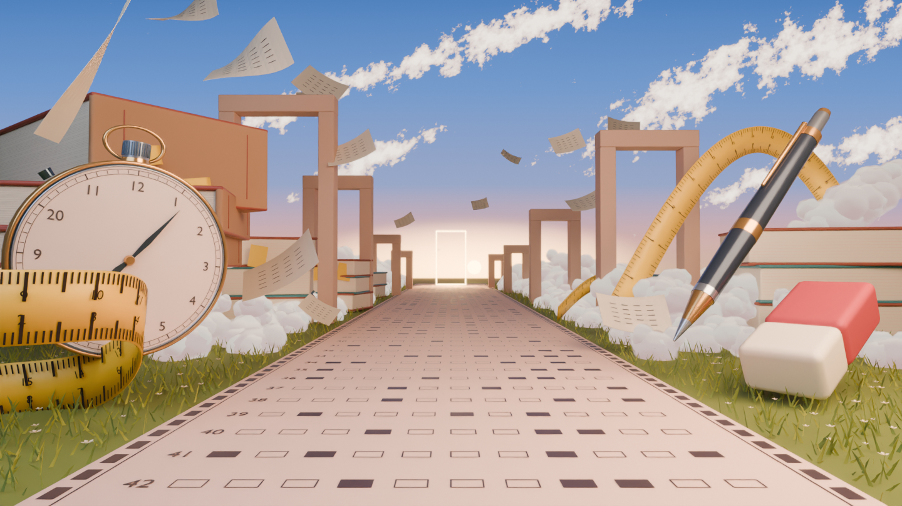
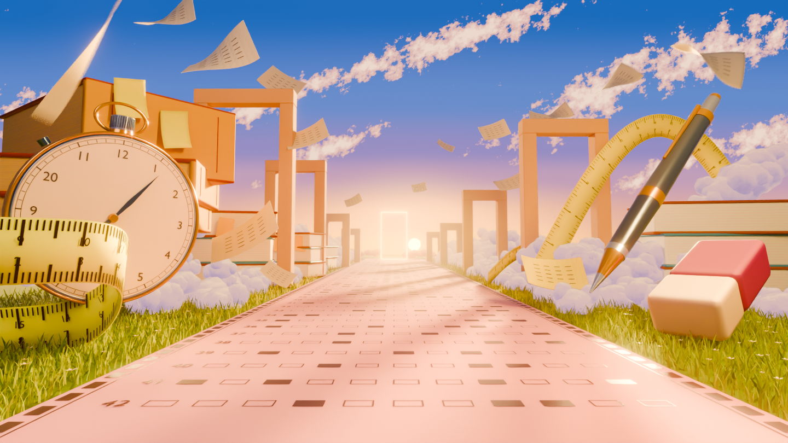

# 第一章 考试道路场景

*项目初期生成的效果图，用来确定场景的构图和视觉方向。*

## 场景设计

我们一共设计了四个场景，考试道路是第一个。答题卡变成一条伸向晨光的道路，路边散布着比例夸张的闹钟、铅笔和形状怪诞的云朵，试卷在空中四处翻飞。我们用这些熟悉却变形的考试物件，表现主角赶赴考场时的紧张感。

## 从效果图到 Blender 场景

我们先生成了页面顶部的效果图，用它确定道路透视、道具的位置和整体氛围。接着，我们把效果图交给 Codex，通过 Codex 连接 Blender，以效果图为参考搭建可编辑的三维场景。搭好道路和周边道具后，我们调整了灯光，完成最终渲染。

### 打光前的模型

这张图记录了最终打光前的场景，可以看到道路、模型和材质的布局。

### 最终渲染

## 文件

| 文件 | 内容 |
| --- | --- |
| [exam_landscape_final.blend](source/exam_landscape_final.blend) | 可编辑的 Blender 总场景 |
| [initial-concept.png](renders/initial-concept.png) | 初始生成的效果图 |
| [before-lighting.png](renders/before-lighting.png) | 打光前的模型预览 |
| [standard-answer-avenue.png](renders/standard-answer-avenue.png) | 最终相机渲染，1440 × 810 |

打开源文件时，请先启动 Blender 5.3，再通过 **File → Open** 选择 .blend 文件。
