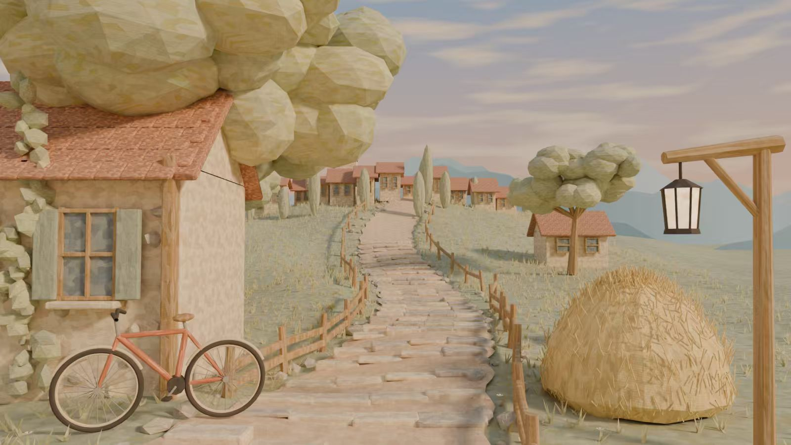
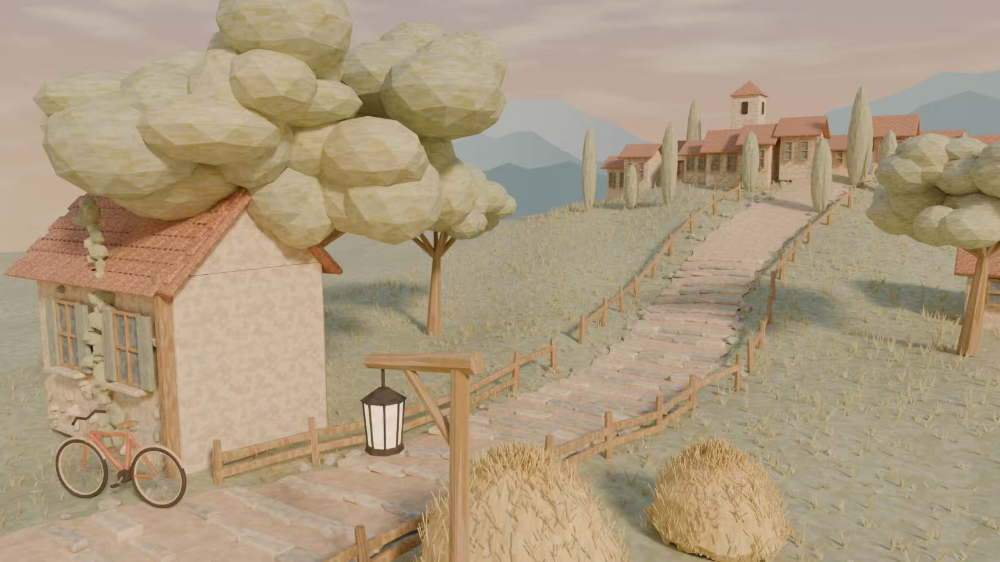

# Chapter 02 countryside environment

## Progress update

The countryside scene for Chapter 02, Everyone's Own Pace, has been modeled in Blender using a Codex-to-Blender workflow. UV mapping and texture application have been completed for this scene iteration. The editable Blender scene, texture archive, and two rendered previews are included for team review and further integration.

The previews show the main path and wooden bridge, foreground cottage and bicycle, fences, lantern post, haystacks, trees, vegetation, distant village, and mountain backdrop. The scene develops the warm, softly textured countryside direction established during concept design.

## Included files

| File | Purpose |
| --- | --- |
| [country_lane_uv.blend](source/country_lane_uv.blend) | Editable Blender scene |
| [country_lane_uv_textures.zip](source/country_lane_uv_textures.zip) | Supplied texture package |
| [country-lane-front.jpg](renders/country-lane-front.jpg) | View along the main path |
| [country-lane-overview.jpg](renders/country-lane-overview.jpg) | Elevated overview of the scene layout |

## Opening and handoff

Download the Blender file and texture archive together. Extract the texture package, open the scene in Blender, and use File > External Data > Find Missing Files if Blender asks for texture locations. Save a working copy before making changes.

This update records the completed modeling and UV-texturing work reported by the scene contributor. The supplied archives have been checked for ZIP integrity. The Blender file has not been opened or re-rendered as part of this repository sync, so texture-path portability and runtime performance still need team verification.

## Next integration steps

- Review scale, object names, and scene organization in Blender.
- Export the required runtime assets with materials and textures.
- Connect the scene to the existing runner, camera, collision, bicycle pickup, and chapter progression systems.
- Test visual fidelity and performance in the browser build.

The source assets and previews are ready for review. Browser integration remains a separate implementation step.
